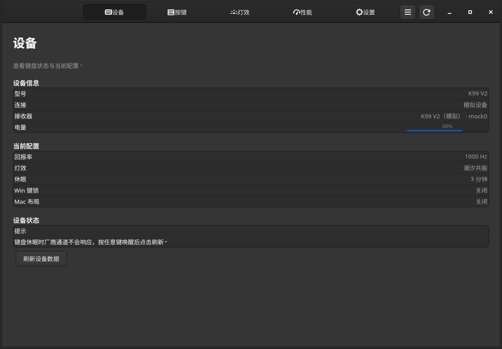
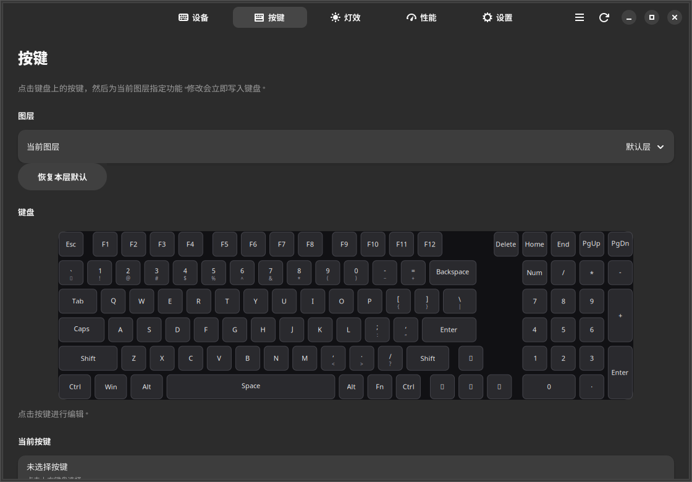
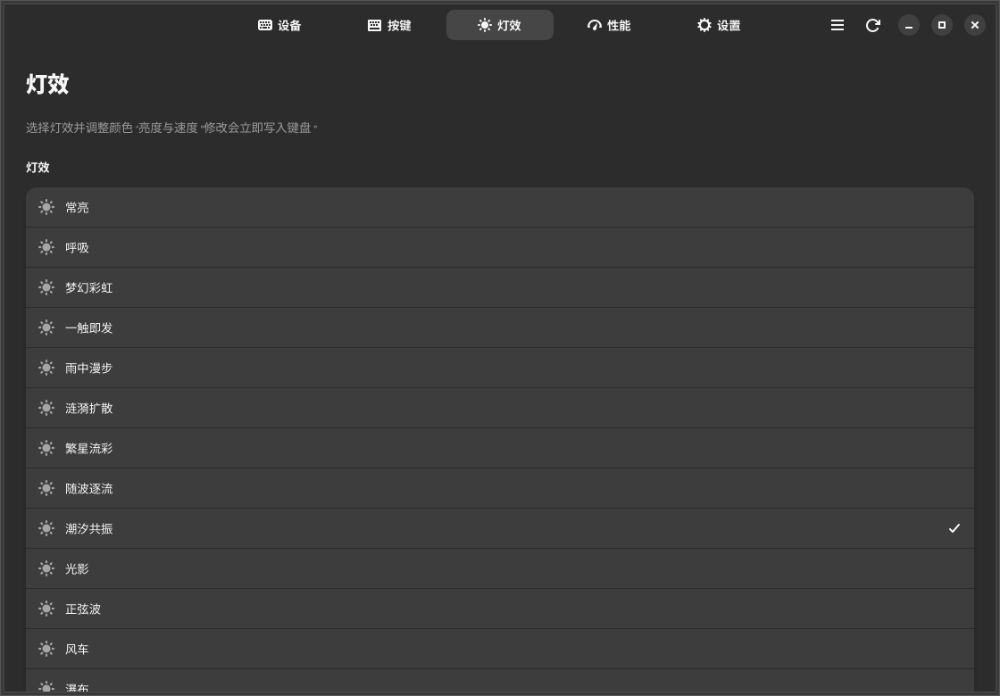
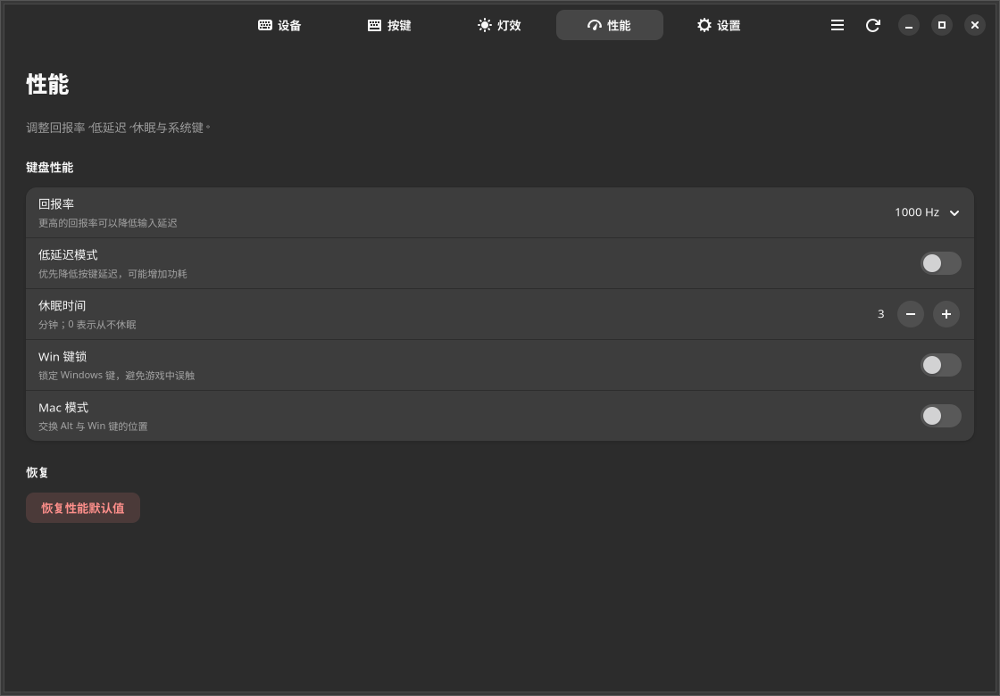
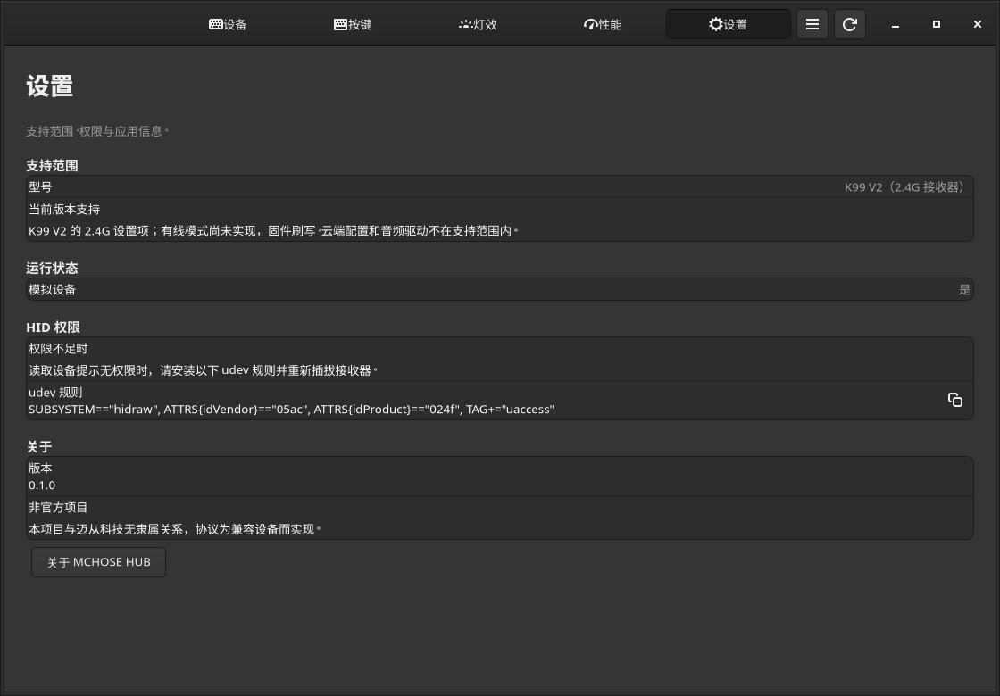

# MCHOSE HUB for Linux

English | [简体中文](README-zh.md)

A native Linux configuration app for the MCHOSE K99 V2, written in Rust + GTK4 + libadwaita. No Electron, Wine, or browser WebHID required.

> **Unofficial project**: not affiliated with MCHOSE Technology. The protocol and model data are interoperability information derived from analyzing the public HUB web client; this repository contains no official binaries, frontend code, or image assets.

**Status: v0.2.0. USB wired and the 2.4G wireless receiver on the K99 V2 are verified on real hardware (2026-10-25); key commands and per-key lighting are verified with the simulated device and still need real-hardware testing (2026-10-27).**



## Features

- **Device info**: model, current connection, discovery status of the USB wired and 2.4G receiver interfaces, battery, charging state, polling rate, current lighting effect, sleep, Win lock, Mac mode. Battery is re-read every 10 seconds, and a notification appears when charging starts or stops.
- **Dual-connection discovery**: when both interfaces are plugged in, each shows "detected / not detected"; USB wired is preferred, falling back to the 2.4G receiver when the wired interface cannot be opened. Plugging in the USB cable while wireless switches to wired within about 0.5–1 s (the keyboard only uses the wired link in the OFF position, so when wired appears the 2.4G link is necessarily unresponsive).
- **Keys**: a natively drawn 99-key K99 V2 layout (redrawn by functional layout; the physical positions of navigation and arrow keys follow the actual keyboard), with default / Fn / Fn2 layers; a key can be remapped to a keyboard key, a modifier, a mouse button, a media key, a shortcut function, or be disabled.
- **Lighting**: Static, Breathing, Dreamy rainbow, Instant response, Rainwalk, Ripple, Starflow, Drift, Tidal resonance, Shadows, Sine wave, Pinwheel, Waterfall, Blossom, Custom, Off; color, brightness, speed, and multicolor are adjustable. Selecting "Custom" reveals the 99-key layout and a palette: click a key to paint it, click again to clear it.
- **Key commands**: record and maintain them in the "Key commands" area of the "Keys" page (click an entry to edit it, use the trash icon on the right to delete it); names are 2–15 characters, with three execution types (repeat while held / repeat until any key / run once) and a horizontal node chain. While recording, presses and releases are captured automatically and default 50 ms gaps are inserted; you can apply a "standard delay" to all nodes, change the delay of individual nodes, and insert keyboard keys / mouse buttons / delays between nodes. Command names and nodes live in `~/.config/mchose_hub_linux/commands.json` on this machine, while the execution type and slot number live in the keyboard's key table, so they survive restarts; deleting a command disables the keys that reference it and shifts later slots forward. Assign them from the "Command" tab of "Change action".
- **Performance**: 250/500/1000 Hz polling rate, low-latency mode, sleep timeout, Win key lock, Mac layout (software Alt/Win swap).
- **Restore defaults**: per-layer key restore, performance restore, lighting color restore.
- **Simulated device**: fully demo and test the UI without a keyboard: `--simulate`.
- **Diagnostics**: `--probe` exports a read-only dump (including the per-key lighting and key command tables); `--probe-write` writes everything back as-is and verifies it.

| Keys | Lighting |
|---|---|
|  |  |

| Performance | Settings |
|---|---|
|  |  |

*Screenshots show the simulated device with the dark theme.*

## Scope and limitations

Supported:

- MCHOSE K99 V2 over **USB wired** or the **Compx 2.4G Wireless Receiver**; when both are plugged in, wired is preferred, and the device page shows the discovery status of both interfaces at once.
- On Linux the device identifies itself as `05ac:024f` (Apple Aluminium Keyboard). The app recognizes it by product string and vendor HID reports: the wireless receiver uses a 20-byte output report with Report ID 19, the wired interface uses a 519-byte Feature Report with Report ID 6, so a real Apple keyboard is never grabbed by mistake.

Not supported yet:

- Other MCHOSE models, magnetic-switch keyboards (they need a different protocol and model data).
- Reading stored command names and nodes back from the keyboard: the wired `0x82` returns the key table contents, and the official frontend never reads them back either, so names are stored locally only.
- Deleting command slots the app doesn't recognize on the keyboard: before saving, the app warns which slots will be overwritten.
- Firmware flashing / OTA.
- Cloud configuration, music reactive lighting, GIF lighting, the Windows audio driver, THX, and other features.
- Key command recording only captures keyboard keys; mouse buttons are added through the node action "Insert a mouse button".
- The Mac layout only swaps Alt/Win on the default layer (software implementation) and does not change F1–F12; for the full firmware Mac mode, press **Fn + S / Fn + A** on the keyboard.

In wireless mode the vendor channel stops responding once the keyboard sleeps. **Press any key to wake it, then click the refresh button in the top-right corner.**
The app uses a single 700 ms probe to decide whether the keyboard is asleep, so it doesn't have to sit through the full retry timeout on every read command; while asleep the plug/unplug scan slows to 1.5 s (0.9 s while awake), and plugging in the cable switches over within about 1.5 s. Scanning pauses while the window is in the background and runs immediately when it returns to the foreground.

## Building and running

Dependencies:

- Rust stable, [mise](https://mise.jdx.dev/) recommended: `mise install`
- Development packages for GTK 4.18+ and libadwaita 1.6+ (pkg-config must find `gtk4` and `libadwaita-1`)
- Meson / Ninja (optional, for installation and Flatpak)

Ubuntu / Debian:

```bash
sudo apt install libgtk-4-dev libadwaita-1-dev meson ninja-build
```

Fedora:

```bash
sudo dnf install gtk4-devel libadwaita-devel meson ninja-build
```

Build with Cargo directly:

```bash
mise install
cargo build --release
./target/release/mchose_hub_linux            # real device
./target/release/mchose_hub_linux --simulate # simulated device
./target/release/mchose_hub_linux --help     # help
```

If you can't install the libadwaita development packages with root privileges, build with GNOME Builder / Flatpak instead (the manifest is already set up), or unpack the dev packages into user space, add them to `PKG_CONFIG_PATH`, and build with Cargo.

Install with Meson:

```bash
meson setup build --prefix="$HOME/.local"
meson compile -C build
meson install -C build
```

Flatpak / GNOME Builder:

```bash
flatpak-builder --user --install --force-clean builddir top.ddmt.mchosehub.json
```

The manifest already includes `--device=all` for access to `/dev/hidraw*` (a broad scope that can be narrowed for releases). It requires `org.gnome.Sdk` 50 (or a compatible version) and `org.freedesktop.Sdk.Extension.rust-stable`.

## Language

The UI follows the system language (`LC_MESSAGES`, `LANGUAGE`); there is no switch in the settings. Translations live in `po/`: `po/LINGUAS` declares en_US and zh_CN, and `po/POTFILES.in` is the extraction list.

```bash
ninja -C build mchose_hub_linux-pot      # re-extract msgids
msgmerge -U po/en_US.po build/po/mchose_hub_linux.pot
LC_ALL=en_US.UTF-8 ./target/release/mchose_hub_linux   # start with the English UI
```

The key and lighting effect names in `data/models/k99_v2.json` can't be picked up by xgettext, so they are registered by hand at the end of each `.po` file; keep them in sync when renaming them.

## HID permissions (udev)

Some distributions only allow root to read hidraw by default. To install the rule:

```bash
sudo cp udev/70-mchose-hub.rules /etc/udev/rules.d/
sudo udevadm control --reload-rules
sudo udevadm trigger
```

Then unplug and replug the keyboard. The rule is:

```udev
SUBSYSTEM=="hidraw", ATTRS{idVendor}=="05ac", ATTRS{idProduct}=="024f", TAG+="uaccess"
```

The "Settings" page in the app can also copy this rule. On the current development machine systemd-logind has already granted the current user access via ACL, so no extra configuration is needed.

## Usage

1. Connect the K99 V2 with a USB cable, or plug in the 2.4G receiver; on wireless, press any key to wake the keyboard.
2. Start the app and wait for the device page to finish reading. The device page shows whether the USB wired interface and the 2.4G receiver are detected; when both are present, wired is preferred, and plugging in the USB cable while wireless switches over automatically.
3. Change settings on the "Keys / Lighting / Performance" pages; every change is written to the keyboard immediately and verified by reading it back.
4. If the app reports a timeout, press any key to wake the keyboard and click refresh.

Changes apply immediately, item by item, with no "Save" button. The error bar at the top and the bottom toasts show write results or errors.

## Diagnostic commands

```bash
# Read-only: print the transport, battery, performance, lighting color, per-key lighting,
# key command table, and the three key layers
./target/release/mchose_hub_linux --probe

# Read everything, then write performance, the three key layers, lighting, per-key lighting,
# and the command table back unchanged and verify them.
# Nothing is changed; use it to validate the HID link
./target/release/mchose_hub_linux --probe-write
```

`--probe` and `--probe-write` don't start the GUI and are handy for diagnosing permission or sleep problems. `--help` and `--version` print usage and the version.

## Tests

```bash
cargo test
```

Coverage:

- Packet encoding/decoding, checksums, chunking and reassembly;
- the 519-byte wired Feature Report request layout, response header validation, and HID descriptor detection;
- dual-interface discovery, wired preference, and the wireless fallback when wired can't be opened;
- device info / performance field offsets, lighting color offsets, and the three-layer key table encoding;
- layer selector bytes and the YY encoding regression;
- key command table: directory addressing, 4-byte node bit order (press/release, extended keys, mouse, three-part delays), name encoding, and rejection of oversized and corrupt tables;
- per-key lighting: three 126-byte planes, click to paint / click again to clear, the 27-frame YY=14 write, and the wired read/write header;
- connection events of the simulated device service.

The assertions were validated with negative controls: flipping the release bit, swapping the delay high/low bytes, switching the directory to big-endian, changing the DIY write header length to 378, and removing the macro read descriptor each make an assertion fail (all run before the fix was finalized).

Real-hardware verification (K99 V2):

- USB wired: the 519-byte Feature Report is recognized; battery, performance, lighting, and the default / Fn / Fn2 layers are read; performance, the three layers, and lighting are written back as-is and read back byte-identical;
- 2.4G wireless: battery, performance, lighting, and the three layers are read; performance, the three layers, and lighting are written back as-is and read back byte-identical;
- toggling the Win lock in the UI reads back the same state on the device page;
- the device page shows the discovery status of both interface types at once: with only the receiver plugged in it shows "2.4G wireless receiver detected · hidraw5" and "USB wired not detected" (verified with Xvfb + real hardware + OCR);
- wired preference, wireless fallback, and the automatic switch when plugging in the cable during wireless use are covered by unit tests of the selection logic; the real-hardware case with both interfaces plugged in has not been retested.

Each page of the UI was screenshotted under Xvfb with the simulated device, and the device page, keyboard rendering, action picker, lighting page, performance page, and write events were verified with OCR. On 2026-10-27 AT-SPI was used to verify the key command section of the keys page, "2 saved", the command tab listing both commands stored on the keyboard, and that assigning one succeeds and shows the key function as "Macro". The node interactions of the recording dialog, the click-to-paint interaction, and the rule that filtered-out slots can't be clicked are **not yet verified automatically** (Xvfb has no window manager, so pointer and keyboard focus are unreliable); they need a check on a real desktop.

## Architecture

```
src/
  model.rs            model data (K99 V2 layout/key table/actions/defaults)
  protocol.rs         packets, checksums, chunking, performance/key table/lighting/per-key lighting structures
  macro_table.rs      key command table: directory + body codec, node bit order
  device/
    hidraw.rs         hidraw enumeration, wireless/wired detection, Feature Report ioctl
    link.rs           wireless RealLink, wired WiredLink, ACK/read-back verification
    mock.rs           simulated device
    service.rs        background device thread, events/requests
  ui/
    mod.rs            Adw window, five pages, event-driven
    keyboard.rs       native scalable keyboard widget (remap display / per-key paint modes)
    macro_editor.rs   key command recording dialog
data/models/k99_v2.json
docs/protocol.md      protocol notes
```

Protocol highlights (see [docs/protocol.md](docs/protocol.md)):

- Wireless: HID Report ID `0x13`, a 20-byte output report each time; the 19-byte payload is `[command, total packets, packet index, YY, 14 bytes of data, checksum]`; checksum = Report ID + the first 18 bytes (mod 256);
- Wired: HID Report ID `0x06`, a 519-byte Feature Report; `[command, 5 bytes space0, data, 0 padding]`, using `HIDIOCSFEATURE/HIDIOCGFEATURE` (520-byte buffer including the Report ID);
- the keyboard key table is 113 slots × 4 bytes, padded with 58 zero bytes and `0x5A 0xA5` when written;
- wireless layers are distinguished by the high nibble of YY (0 = default, 1 = Fn, 2 = Fn2), while the low nibble is the payload length of the packet; wired layers live in the first byte of space0.

## Data sources and licensing

- Protocol and model data come from static analysis of the public HUB web client and are used only for interoperability and Linux compatibility; the repository contains no official code, binaries, or images.
- Key positions, HID codes, default key values and similar data are device facts; the UI, the Rust implementation, and the protocol documentation are original to this project.
- The UI symbolic icons come from the GNOME Adwaita icon theme (CC-BY-SA-3.0/4.0 or LGPL-3.0, credit to the GNOME Project) and are bundled into the app resources; naming follows the GNOME Icon Library dev-kit. See `data/icons/mchose/README.md` for details.
- License: GNU GPL-3.0-or-later (see `COPYING`).

## Roadmap

- Capture mouse buttons while recording key commands;
- 22 magnetic-switch keyboards (Ace / Jet / K / Mix / G / ZERO series);
- more legacy models;
- English UI and translations.

Issues and PRs are welcome, especially `--probe` output and HID descriptors for other models.

## Pre-release checklist

- Add the project homepage `url` in `data/top.ddmt.mchosehub.metainfo.xml.in` and re-enable the AppStream validation in `data/meson.build`.
- Narrow the Flatpak `--device=all` permission for the target distributions.
- Add the English translation or notes.
